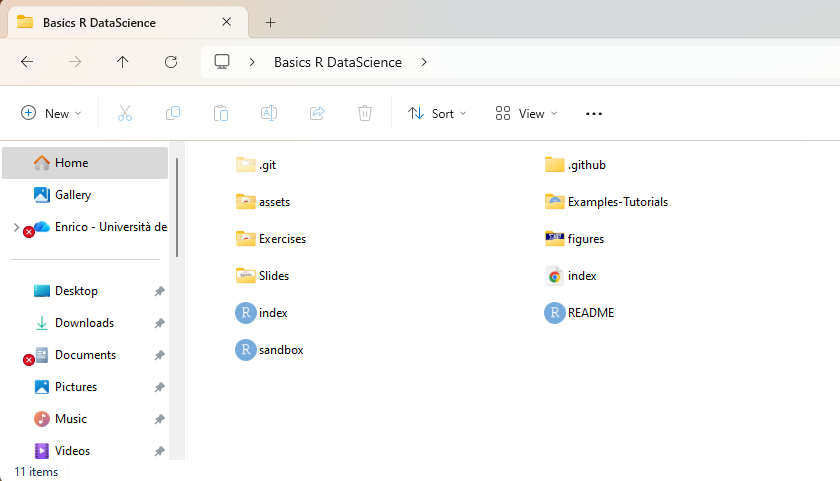
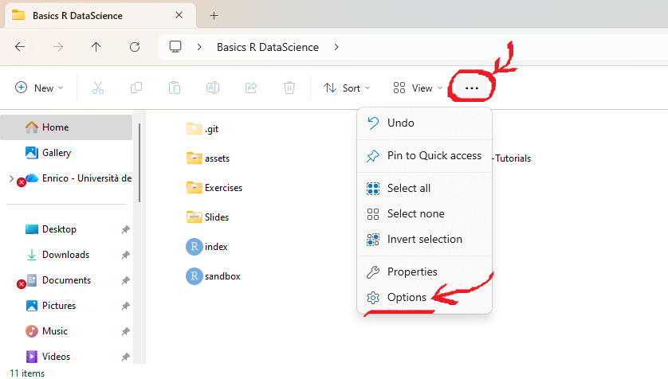
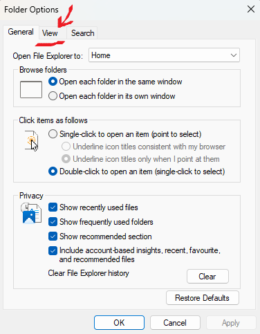
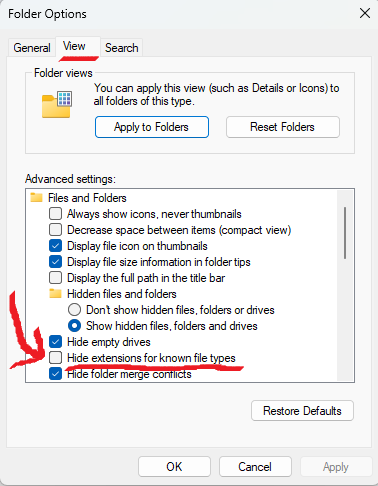
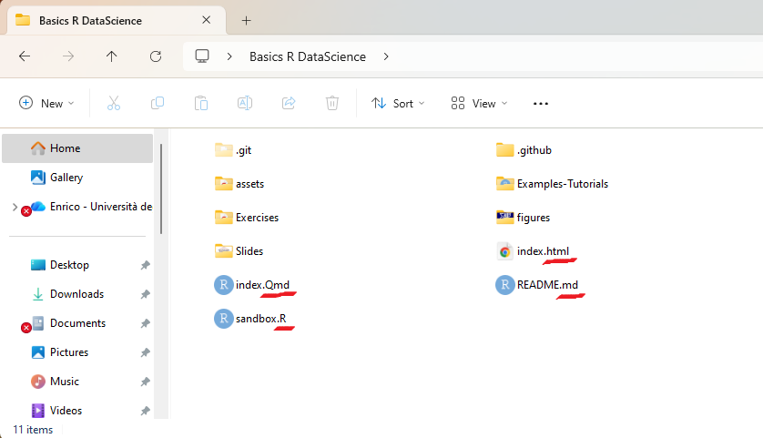

A file extension is the short group of letters that comes after the dot (`.`) in a file name — for example:

-   `report.pdf` → extension: `.pdf`
-   `photo.jpg` → extension: `.jpg`
-   `script.R` → extension: `.R`

The extension tells the operating system and software what type of file it is, and which program / app should be used to open it.

For instance, these are common associations:

-   `.html` → default browser
-   `.docx` → Microsoft Word document
-   `.xlsx` → Excel spreadsheet
-   `.png` → photo viewer
-   `.R` → R file, opened with RStudio

For better or for worse, Windows tends to hide known file extensions, so you may see something like this (i.e., **NO** file extensions visible next to the file names):

</img>

Sometimes, however, you may want to explicitly view & edit the file extensions to understand what they really are, or to fix / change them manually (e.g., from `.txt` to `.csv` for managing datasets, from `.txt` to `.R` for turning plain-text files into R scripts, from `.md` to `.Qmd` for managing markdown documents, from `.pptx` to `.zip` for easier access to media inside PowerPoint slides)

------------------------------------------------------------------------

## Ok, now how can I view file extensions in Windows?

Here's how to do it... The following was done on Windows 11, but other versions of Windows are only slightly different.

##### Step 0: open a folder - doesn't matter which, just open any folder!

##### Step 1: open the `Folder Options` panel

</img>

##### Step 2: go to the `View` tab

</img>

##### Step 3: remove the checkmark from the *`Hide extensions for known file types`* option under the `Advanced settings` menu, so that extensions are NO longer hidden

</img>

##### Step 4: go back to your folder, or wherever there are files (not just folders), and check that the file extensions are now visible

</img>

##### ⚠️ Be careful! Unhiding the extensions will now show file extensions throughout your operating system, in any folder. From now on, if you accidentally change a file extension (for example while renaming the file) this may affect the default app with which that file is opened (therefore, the file may no longer behave as it did before, until the original extension is restored)
