## How popular is R?

<div style="font-size:26px;">
[**TIOBE index**](https://www.tiobe.com/tiobe-index/){target="_blank"} of programming languages popularity: in **November 2026** R ranks **# 7** worldwide (2.27%), its highest position ever, after Python, C, Java, C++, C#, JavaScript (see [R history](https://www.tiobe.com/tiobe-index/r/){target="_blank"})
</div>

::: {.r-stack}
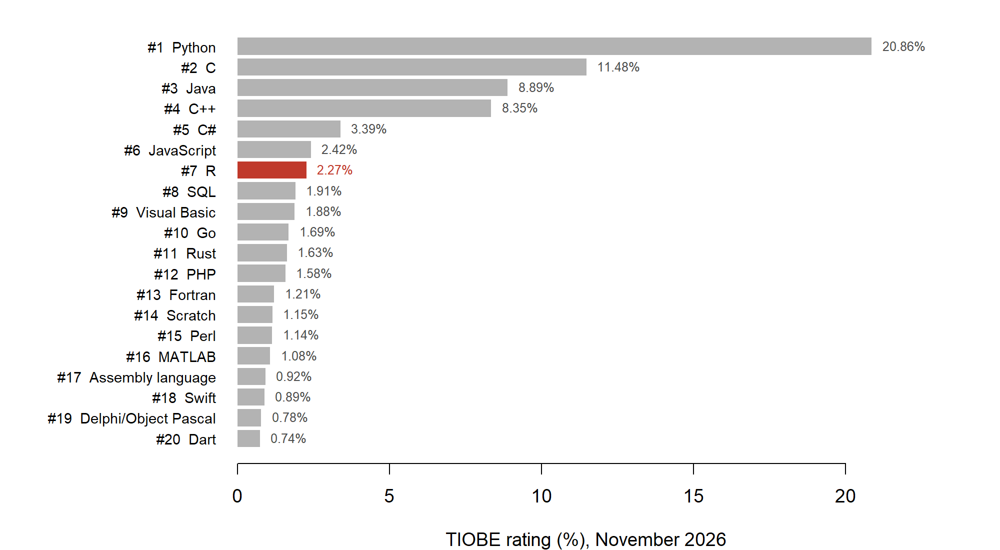

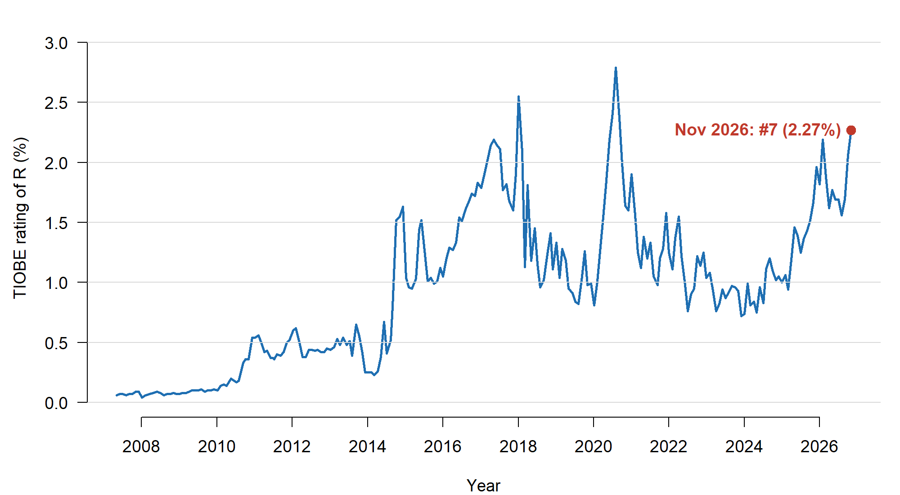
:::

## Why become an R user?

<div style="font-size:30px;">
- **Mainstream in academia** for statistical computing and data science, also widely used in business. *Job market advantage!*

- **Free & open-source**: wherever you go, R will be with you at no cost (unlike *MATLAB*, *MPLUS*, *SPSS*, etc.)

- **Real programming language**: difficult at the beginning, but: 1) gives you lots of flexibility; 2) transfers to other programming languages (e.g., <em>**Python**</em>).

- **Vast community support** thanks to a large and active community (plus *ChatGPT*, *Gemini*, *Lucrez-IA*, etc. know it pretty well!).

- **Huge ecosystem**, >25,000 packages on CRAN, more from other sources (e.g., GitHub), to do amazing stuff with statistical data analysis, machine learning, data visualization, developing webapps [*shiny*], writing reports and even entire books [*bookdown*, *rmarkdown*]; also, it can integrate with *Quarto*, *GitHub*.

- Facilitates **reproducible scientific research** by sharing code and workflows.
</div>

## What you may expect to learn in this course:

<div style="font-size:40px;">
- Using basic operations and functions; 

- Working with most important data types and structures;

- Gaining some proficiency in managing and manipulating data with vectors and dataframes; 

- Understanding some fundamental concepts of programming; 

- Building the foundations to delegate more complex tasks to AI agents... while retaining control. 
</div>

##
### Over the next two years, following this PhD program, you have the opportunity to use R for the fundamentals of...

<div style="font-size:36px;">
- Core **statistical inference** methods;

- **LM/LMM/GLMM**: (Generalized) linear (mixed-effects) models;

- **Data visualization** using *ggplot2*;

- Power analysis & more via **data simulation**; 

- **SEM** (Structural Equation Modeling); 

- Conducting **meta-analysis**.
</div>

## you may even create greeting cards

<div style="text-align: center;">
  <a href="https://github.com/EnricoToffalini/Basics-R/blob/main/Slides/figures/christmasTree.R" target="_blank">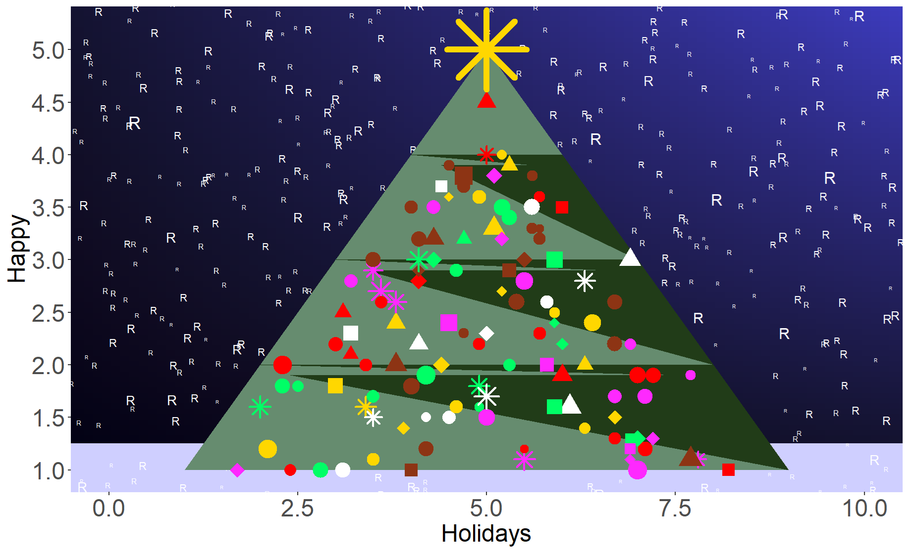</a>
</div>

## you may even create greeting cards

<div style="text-align: center;">
  <a href="https://github.com/EnricoToffalini/Basics-R/blob/main/Slides/figures/happyBirthday.R" target="_blank">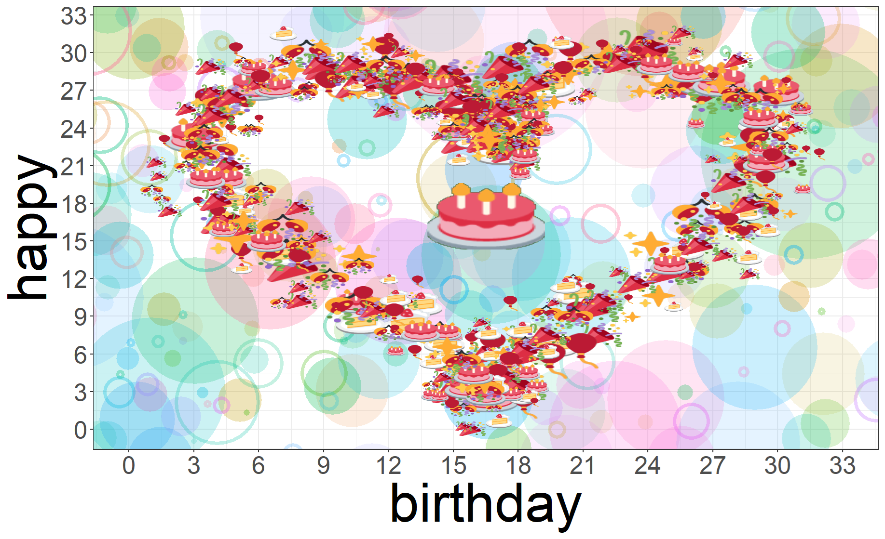</a>
</div>


## or fancy infographics

<div style="text-align: center;">
  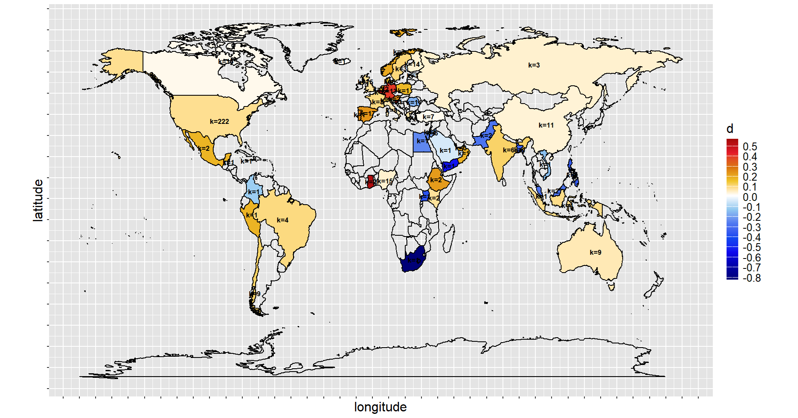
</div>


## or fancy infographics

<div style="text-align: center;">
  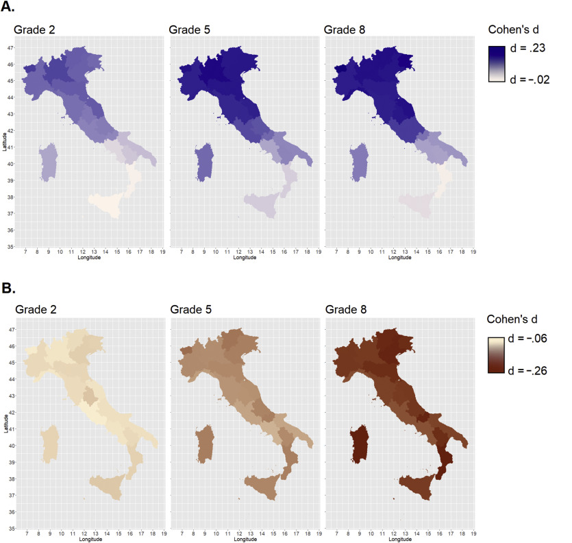
</div>


## or perform fancy moderated meta-analyses

<p class="small">*Optional / self-study*</p>

<div style="text-align: center;">
  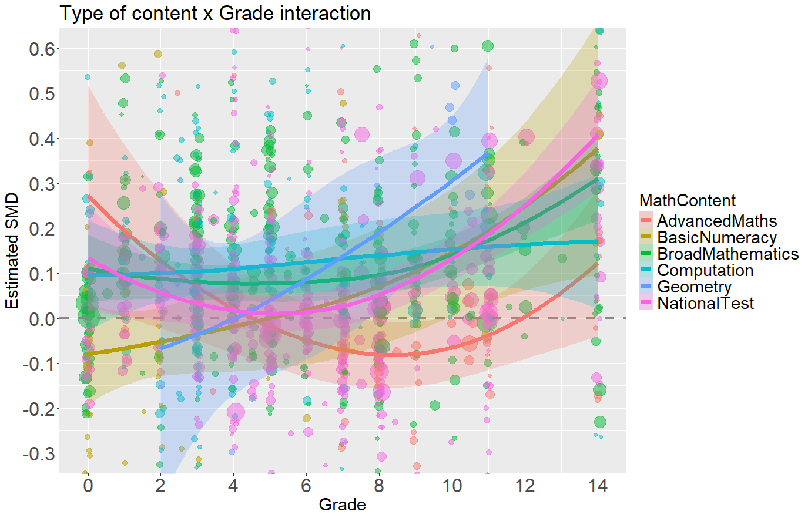
</div>


## you may create interactive webapps with Shiny

\
see [**Shiny gallery**](https://shiny.posit.co/r/gallery/#feature-demos){target="_blank"}

\
here are a couple of recent real examples from **Psicostat** members:

- this [game-like shiny app](https://psicostat.shinyapps.io/science4allshiny/){target="_blank"} developed for the science4all event in Padova; see [here](https://psicostat.github.io/science4all/){target="_blank"} for an explanation in Italian

- practical [ad-hoc shiny app](https://enricotoffalini.shinyapps.io/TimeTasks/){target="_blank"} for scoring experimental data collected by students

## you may create interactive webapps with Shiny

<div style="text-align: center;">
  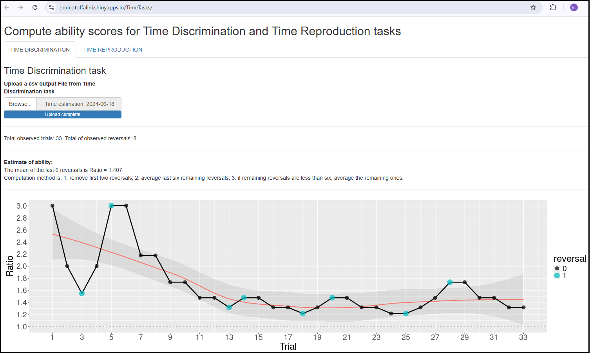
</div>

## or entire websites and books

examples of other resources that can be **created within the R ecosystem**, integrating other tools such as *GitHub* and *Quarto*:

- this very [course support material](https://enricotoffalini.github.io/Basics-R/){target="_blank"} is a website in its own right

- this very [course textbook](https://psicostat.github.io/Introduction2R_EN/){target="_blank"} is a book/website

- [this book](https://lakens.github.io/statistical_inferences/){target="_blank"} by Daniël Lakens explaining Statistical Inference


## R + *Integrated Development Environment*(s)

Make sure you install:

- <a href="https://cran.r-project.org/" target="_blank">**R**</a> as the programming language interpreter and the basic environment and packages
- <a href="https://posit.co/download/rstudio-desktop/" target="_blank">**RStudio**</a> is the IDE of choice to make writing R code easy

Interesting alternatives to installing RStudio:

- <a href="https://positron.posit.co/" target="_blank">**Positron**</a> (based on MS Visual Studio Code)
- <a href="https://posit.cloud/" target="_blank">**Posit.cloud**</a> (fully online, actually RStudio)
- <a href="https://colab.research.google.com/" target="_blank">**Google Colab**</a> (fully online, make sure to set *R runtime type*; actually a Jupyter notebook)

## R Console (just base R)

<div style="text-align: center;">
  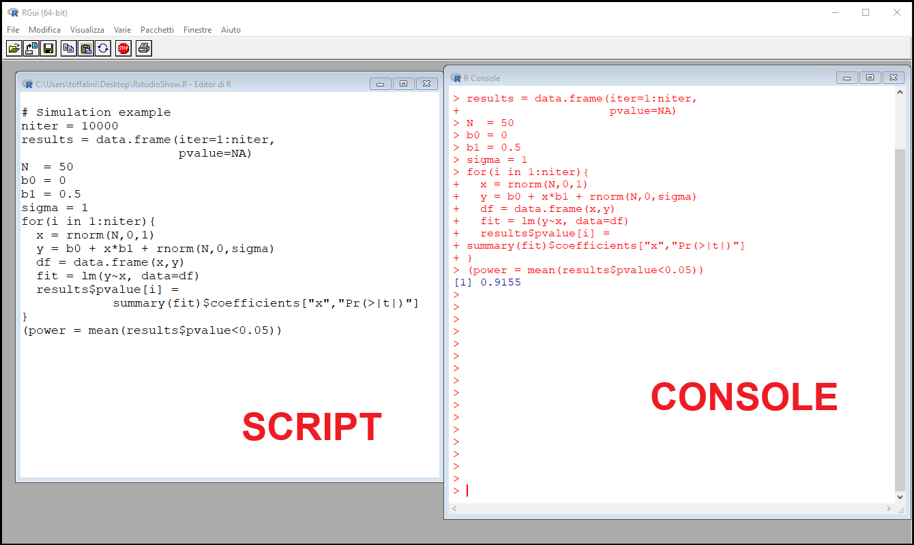
</div>

## RStudio (full IDE)

<div style="text-align: center;">
  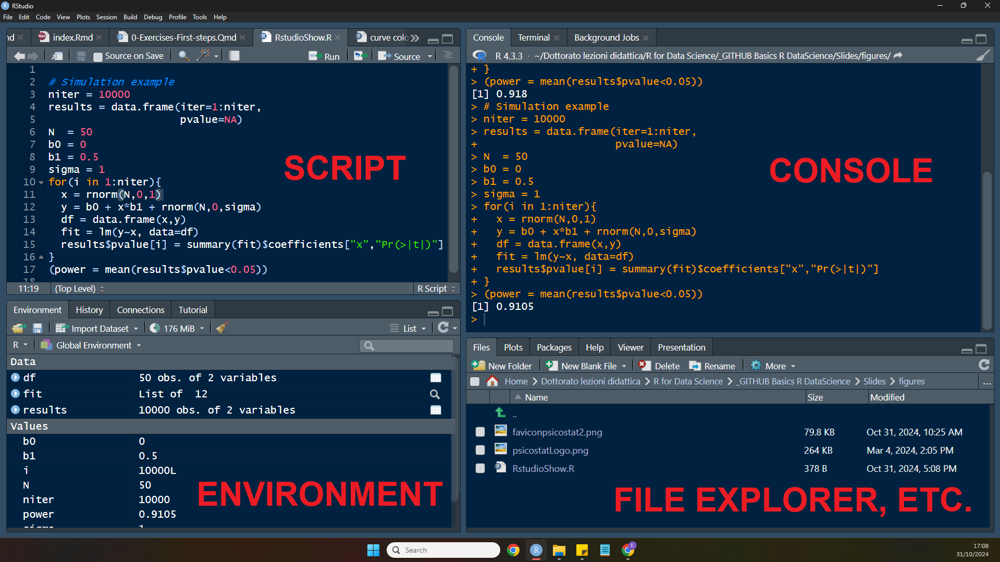
</div>

## Google Colab (online notebook)

<div style="text-align: center;">
  <a href="https://colab.research.google.com/drive/1fSiTnDShj1YOrsujqkkzwgFaGCjm2utm" target="_blank">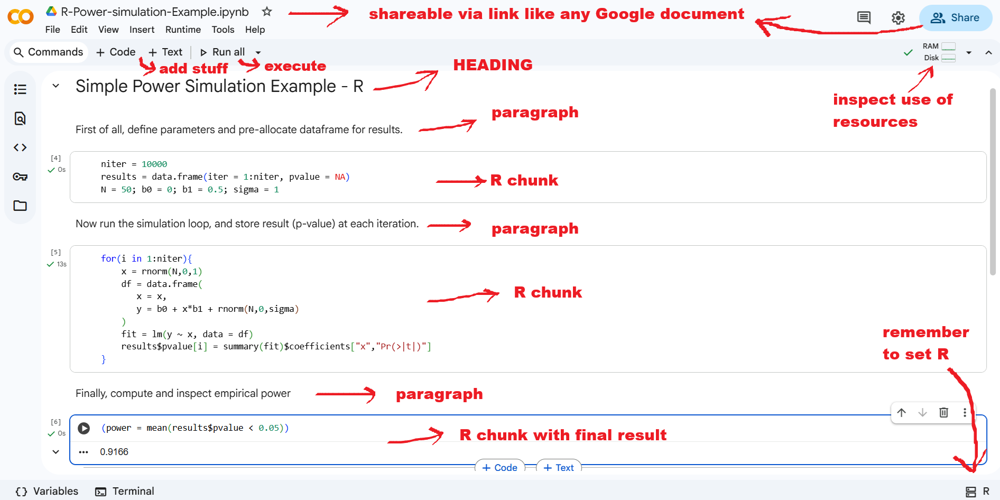</a>
</div>


## (Re)start with a clean session

In your **RStudio**, I suggest that you go to **Tools > Global Options > General** and:

- Uncheck **"Restore .RData into workspace at startup"**.
- Set **"Save workspace to .RData on exit"** to **`Never`**.

Your saved scripts (`.R` files) should be what recreate all objects. In some cases, storing and retrieving selected results is useful (as `.RData`, `.rds`, `.csv`, etc., as we will see later), but it should be done on purpose.

::: {.callout-tip}
Use **Session > Restart R** (or **Ctrl+Shift+F10**) to restart R, then run the script from top to bottom to double-check that it works well (without objects left from the current or earlier sessions).
:::

## Let's Test the Environment!

Let's run a few commands in RStudio to get familiar with its console and see if the installation works properly

```{r}
rnorm(10) # draw 10 random values from a Standard Normal distribution
```
```{r, eval=F}
?rnorm # open the help tab for the "rnorm" function
```
```{r}
round( rnorm(10, mean=100, sd=15) ) # draw 10 values from IQ distribution, round them
```
<p style="font-size:10px;"><br/></p>
```{r, eval=F}
install.packages("psych") # install a package from CRAN
```

```{r}
library(psych) # load the newly installed package

fisherz(rho=0.5) # use it to transform a correlation into a Fisher's z
```

<!-- --------------------------------------------------------------------- -->


##
### Literate programming: Quarto / R Markdown

These slides and the course website are **Quarto (`.Qmd`) files**: text, figures, executable R code, and more are in the same document.

:::: {.columns}

::: {.column style="width: 48%; margin-right: 2%; background-color: #f1f3fc; border: 1px solid #c5cce5; border-left: 5px solid #687bb5; border-radius: 6px; padding: 14px; box-sizing: border-box;"}

<div style="font-size: 20px; font-weight: 600; border-bottom: 1px solid #c5cce5; padding-bottom: 8px; margin-bottom: 14px;"><em>Quarto source (<code>.qmd</code>)</em></div>

<pre><code>## Random values
### A first example

Let's try a basic function in R. It simply draws random numbers from a standard Normal distribution...

&#96;&#96;&#96;{r}
rnorm(3)
&#96;&#96;&#96;</code></pre>

:::
::: {.column style="width: 48%; background-color: #eef7f3; border: 1px solid #bfd9cd; border-left: 5px solid #4d9072; border-radius: 6px; padding: 14px; box-sizing: border-box;"}

<div style="font-size: 20px; font-weight: 600; border-bottom: 1px solid #bfd9cd; padding-bottom: 8px; margin-bottom: 14px;"><em>Rendered output</em></div>

<h2 style="font-size: 32px; margin: 0 0 8px;">Random values</h2>

<h3 style="font-size: 26px; margin: 0 0 8px;">A first example</h3>

<p style="font-size: 24px;">Let's try a basic function in R. It simply draws random numbers from a standard Normal distribution...</p>

```{r}
rnorm(3)
```
:::
::::

**"Render"** runs the code and combines its output with the text. <br/>
**R Markdown (`.Rmd`)** follows the same idea.

