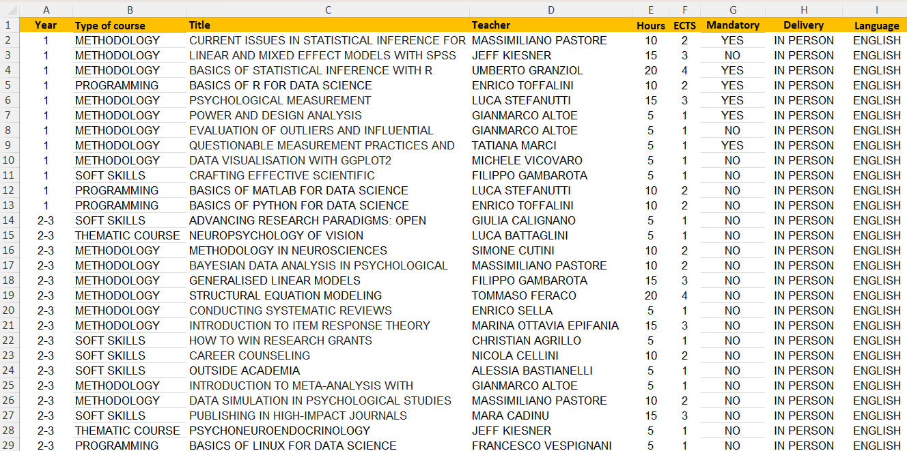
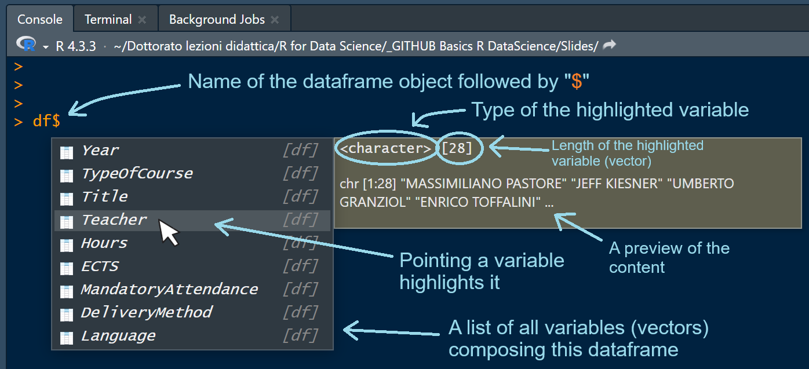
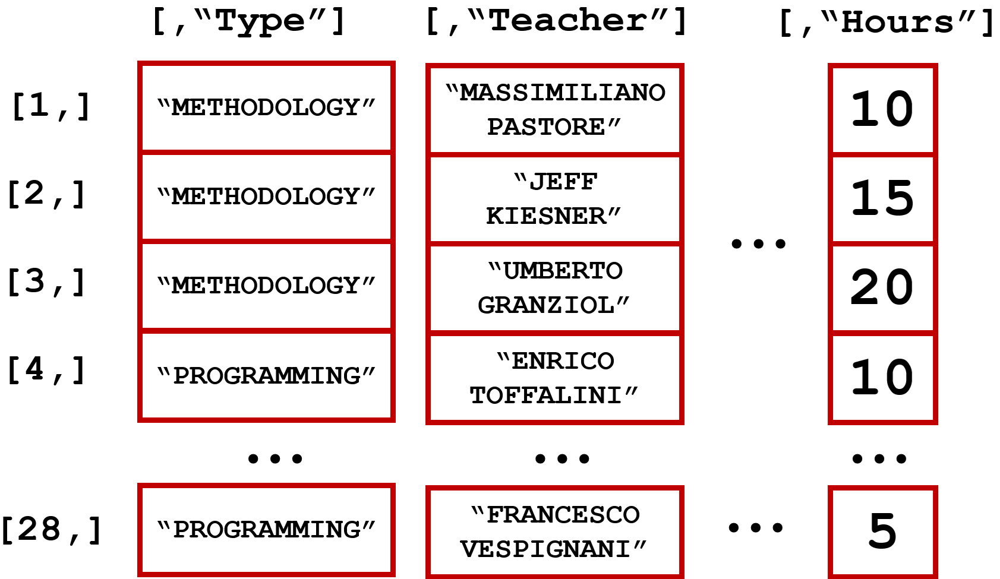

## 
### A type of data structure you are already familiar with

<div style="text-align: center;">
  
</div>

##
### A type of data structure you are already familiar with

Here is how I would import it into R (<a href="data/Courses40Cycle.xlsx" download>download here</a>), and display the first few rows:

```{r}
library(readxl)
df = data.frame(read_excel("data/Courses40Cycle.xlsx"))
head(df)
```

## 
### Dataframes as collections of vectors

In fact, **dataframes** are just collections (lists) of **vectors of different types**, all with the same length. Each column in a dataframe is a vector (a variable):

```{r}
head(df$Teacher)
head(df$Hours)
```

## 
### Basic Functions on Dataframes

To know the names of all variables in a dataframe, use the **`names()`** function:
```{r}
names(df)
```

Use the **`dim()`** function to view the dimensions of a dataframe: 
```{r}
# first value is number of rows, second is number of columns (variables)
dim(df) 
```

Alternatively, you can use **`nrow()`** and **`ncol()`**:
```{r}
nrow(df) # number of rows
ncol(df) # number of columns
```

## 
### Basic Functions on Dataframes

The **`str()`** function provides a quick overview of the structure of a dataframe, including its dimensions, variables, their data types, and the first few observations: 
```{r}
str(df)
```


## Quick overview of a dataframe: `summary()`

**`summary()`** describes each column according to its type. Here are two numeric columns from the course data; try `summary(df)` for all columns:

```{r}
summary(df[ , c("Hours", "ECTS")])
```

:::{.callout-tip}
In RStudio, **`View(df)`** opens the data viewer: it can be useful for quick inspection without using Excel, but best keep all data transformations code in your R script.
:::

## 
### Accessing Elements in Dataframes

The "**`$`**" (dollar) operator is essential to access variables in a dataframe:

<div style="text-align: center;">
  
</div>

## 
### Accessing and Working with Elements in Dataframes

As an exercise, let's check whether `Hours` is actually always `ECTS*5`

We may use many different, increasingly sophisticated, strategies: 
<div class="large-code">
```{r}
df$Hours / df$ECTS

(df$Hours / df$ECTS) == 5

sum((df$Hours / df$ECTS) == 5)

sum((df$Hours / df$ECTS) == 5) == nrow(df)

sum((df$Hours / df$ECTS) != 5)
```
</div>

##
### Accessing and Working with Elements in Dataframes

Variables in a dataframe can be manipulated like any other vector:
```{r}
log(df$Hours)
```

Also, new variables can easily be created and added at any time: 
```{r}
df$newVar = log(df$Hours)
names(df)

head(df$newVar)
```

## 
### Indexing Elements in a Dataframe

In addition to using the "**`$`**" (dollar) operator, you can directly access a variable of a dataframe using **indexing** with **square brackets `[]`**: 
```{r}
df[ , "Hours"]
```

Notice the comma "**`,`**" above.

Unlike vectors, dataframes must be indexed by **both row and column**. In the example above, we’re specifying only the desired column (`"Hours"`), leaving the row index blank before the comma **`,`**. This selects all rows for the column named `"Hours"`. Remember that a blank index means "all". Importantly, the "**`,`**" must always be there when indexing dataframes! 

## 
### Indexing Elements in a Dataframe - Examples

```{r}
df[ 1 , "Hours"]
df[ 1:5 , "Hours"]
df[ 1 , c("Teacher","Hours","TypeOfCourse")]
df[ 1:5 , c("Teacher","Hours","TypeOfCourse")]
df[ 1 , c(4, 5, 2)]
```

## 
### Indexing and Modifying Elements in a Dataframe

Editing/modifying elements in a dataframe is similar to what you do with vectors

<div style="display: grid; grid-template-columns: 1fr 1fr; gap: 20px;"> <div>
```{r, echo=F}
set.seed(0)
```
```{r}
dx = data.frame(name = letters[1:10], 
                score = rnorm(10))
dx
```
</div><div>
```{r}
# Replace some elements with 'NA'
dx[3:5, "score"] = NA
dx
```
</div></div>

## 
### Indexing and Modifying Elements in a Dataframe

Editing/modifying elements in a dataframe is similar to what you do with vectors

<div style="display: grid; grid-template-columns: 1fr 1fr; gap: 20px;"> <div>
```{r, echo=F}
set.seed(0)
```
```{r}
dx = data.frame(name = letters[1:10], 
                score = rnorm(10))
dx
```
</div><div>
```{r}
# Multiply all elements by 10
dx$score = dx$score * 10
dx
```
</div></div>

## 
### Indexing and Modifying Elements in a Dataframe

Editing/modifying elements in a dataframe is similar to what you do with vectors

<div style="display: grid; grid-template-columns: 1fr 1fr; gap: 20px;"> <div>
```{r, echo=F}
set.seed(0)
```
```{r}
dx = data.frame(name = letters[1:10], 
                score = rnorm(10))
dx
```
</div><div>
```{r}
# Linearly transform all elements
dx$score = round( 100 + dx$score * 15 )
dx
```
</div></div>

## 
### Indexing and Modifying Elements in a Dataframe

**Assigning a single value** to a column replaces the value for all rows (this is unlike vectors)

<div style="display: grid; grid-template-columns: 1fr 1fr; gap: 20px;"> <div>
```{r, echo=F}
set.seed(0)
```
```{r}
dx = data.frame(name = letters[1:10], 
                score = rnorm(10))
dx
```
</div><div>
```{r}
# Replace all elements with a constant
dx$score = 3
dx
```
</div></div>

## 
### Indexing Dataframes by Logical Conditions

Just like for vectors, you can use **logical conditions** for indexing a dataframe.

How do you extract **only the rows** related to `"MASSIMILIANO PASTORE"`?
```{r}
head(df[ , c("Teacher", "Hours", "TypeOfCourse")])
```

## 
### Indexing Dataframes by Logical Conditions

Just like for vectors, you can use **logical conditions** for indexing a dataframe.

Let's consider this logical condition:
```{r}
df$Teacher == "MASSIMILIANO PASTORE"
```

Let's extract matching rows and two columns (leave the column index blank for all columns):

```{r}
df[df$Teacher == "MASSIMILIANO PASTORE", c("Teacher", "Hours")]
```


## Matching many values: `%in%`

**`%in%`** asks whether each value matches *any* value in a given vector:

```{r}
teachers = c("MASSIMILIANO PASTORE", "ENRICO TOFFALINI")
df[df$Teacher %in% teachers, c("Title", "Hours", "ECTS", "MandatoryAttendance")]
```

Use **`!(df$Teacher %in% teachers)`** to select everyone else.


## `unique()` and `which()`

**`unique()`** returns the distinct values <br/> **`which()`** returns the positions where a condition is `TRUE`:

```{r}
unique(df$TypeOfCourse)
which(df$Hours > 15)
which.max(df$Hours)
```

:::{.callout-tip}
`which.max()` gives the position of the **first maximum**. These positions can go straight into the row index: `df[which(df$Hours > 15), ]`.
:::

##  {.revision-new background-color="#dff0d8"}
### Sorting: sort() and order()

**`sort()`** rearranges the values in a vector:

```{r}
sort(df$Hours)
sort(df$Hours, decreasing=TRUE)
```

**`order()`** returns positions. Use them to rearrange **whole rows**, keeping each teacher's information together:

```{r, results="hide"}
df[order(df$Hours), c("Teacher", "Hours")]
```

```{r, eval=F}
df[order(df$TypeOfCourse, -df$Hours), ]
```

The second example sorts by course type, then by hours from highest to lowest.

## 
### Indexing Elements in a Dataframe - A Summary

<div style="text-align: center;">
  
</div>


## 
### Subset

The base function **`subset()`** can also be used as an alternative to indexing

```{r}
subset(df, Teacher == "MASSIMILIANO PASTORE", select=c("Teacher","Hours","TypeOfCourse"))
df[df$Teacher == "MASSIMILIANO PASTORE" , c("Teacher","Hours","TypeOfCourse")]
```

Indexing with **`[]`** makes the row and column selection explicit and uses the same logic as vectors and matrices. It also transfers well to other programming languages (e.g., **Python**). Choose the form that makes your code clearest.


## 
### Combine Two Dataframes Using `rbind()`

Imagine you have two datasets collected by two students, each including different participants: 

```{r, echo=F}
df1 = data.frame(subjName = c("Julie","Tommy","Phil"),
                 age = c(12, 10, 10),
                 accuracy = c(.92, .78, .85))
df2 = data.frame(subjName = c("Amber","Max"),
                 age = c(9, 13),
                 accuracy = c(.87, .90))
```

```{r}
df1
df2
```

Our goal is to get one single dataset including all participants' data for the final analysis. Of course, you could combine these files manually outside R (e.g., in Excel). However, it's simpler and more efficient to do this directly in R using `rbind()`


## 
### Combine Two Dataframes Using `rbind()`

<div class="large-code">
```{r}
dfTotal = rbind(df1, df2)

dfTotal
```
</div>

**Important**: for `rbind()` to work, the two to-be-combined dataframes must:

- have the **exact same number of columns**;

- have **identical column names** (remember that R is case-sensitive).


## 
### Merge Two Dataframes Using `merge()`

Another frequent case is having data collected from the **same participants** across **different dataframes**, and having to analyze all information together:

<div class="large-code">
```{r, echo=F}
df1 = data.frame(subjName = c("Julie","Amber","Tommy","Phil"),
                 age = c(12, 9, 10, 10))
df2 = data.frame(subjName = c("Julie","Tommy","Phil","Amber"),
                 accuracy = c(.92, .78, .85, .87),
                 time = c(1203, 3302, 994, 1163))
```

```{r}
df1
df2
```
</div>

## 
### Merge Two Dataframes Using `merge()`

You can merge the two dataframes into a single, comprehensive dataframe: 

<div class="large-code">
```{r}
dfTotal = merge(df1, df2, by="subjName")

dfTotal
```
</div>

**Important**: `merge()` will work even if some or even all values that should be used for merging do not match... but in that case some or all of the data will be lost


##  {.revision-new background-color="#dff0d8"}
### merge() keeping everyone: all=TRUE

Let's reuse the participants from the previous example, but suppose **Amber is missing from the second file**:

```{r}
df2partial = df2[df2$subjName != "Amber", ]
merge(df1, df2partial, by="subjName", all=TRUE)
```

**`all=TRUE`** keeps names found in either file. Missing information becomes **`NA`**; the default merge would lose Amber's row here.


##  {.revision-new background-color="#dff0d8"}
### Missing data in dataframes

Let's inspect the merged data, including the missing values we just created:

```{r}
dfTotal = merge(df1, df2partial, by="subjName", all=TRUE)
colSums(is.na(dfTotal))
complete.cases(dfTotal)
dfComplete = na.omit(dfTotal)
nrow(dfTotal) - nrow(dfComplete)
```

`colSums()` counts missing cells per column here. `complete.cases()` identifies rows without missing values. **`na.omit()` drops entire rows**: always check how many and whether this is appropriate.


##  {.revision-new background-color="#dff0d8"}
### Row-wise scores: rowSums() and rowMeans()

For a small scoring example, sum three subtests from the [WISC data](data/wisc.csv):

<div style="display: grid; grid-template-columns: 1fr 1fr; gap: 20px;"><div>

```{r}
wisc = read.csv("data/wisc.csv")
items = c("BD", "SI", "DS")
wisc$tot = rowSums(wisc[ , items], na.rm=TRUE)
head(wisc[ , c(items, "tot")], 3)
```


</div><div>

```{r, fig.width=4.5, fig.height=2.8}
hist(wisc$tot)
```


</div></div>

With `na.rm=TRUE`, missing items reduce the sum; an entirely missing row gives **0**. `rowMeans()` may be useful for comparable items, but still needs a minimum valid-item rule (all missing gives `NaN`). Follow the scoring protocol.

This three-subtest sum is not a standardized IQ score.


##  {.revision-new background-color="#dff0d8"}
### Summaries by group: aggregate()

**`Hours ~ TypeOfCourse`**: summarize hours separately for each course type.

```{r}
aggregate(Hours ~ TypeOfCourse, data=df, FUN=mean)
```

For several numeric columns, combine them with **`cbind()`**:

```{r}
aggregate(cbind(Hours, ECTS) ~ TypeOfCourse, data=df, FUN=sum)
```

Missing rows are omitted. Later, `tapply()` groups one vector.


##  {.revision-new background-color="#dff0d8"}
### Summaries by group: selected columns

In a formula, **`.`** means “all the other columns”. Select only the columns you intend to summarize:

```{r}
aggregate(. ~ TypeOfCourse,
          data=df[ , c("TypeOfCourse", "Hours", "ECTS")], FUN=mean)
```

The same **`y ~ group`** notation can provide a quick graphical check:

```{r, eval=F}
boxplot(Hours ~ TypeOfCourse, data=df)
```

Try the plot in the console. Proper figure design is covered in the ggplot2 course.

## 
### Contingency Tables

The **`table()`** function, which counts frequencies, can also be used on dataframes. Importantly, it can also create **contingency tables** when applied to multiple variables at once

<div class="large-code">
```{r}
table(df$Hours) # just counts frequencies
```

```{r}
table(df$TypeOfCourse, df$Hours) # creates a contingency table
```
</div>

<!-- --------------------------------------------------------------------- -->

##  {.revision-new background-color="#dff0d8"}
### Wide vs long format

The **same three participants**, measured at three times:

<div style="display: grid; grid-template-columns: 1fr 1fr; gap: 20px; font-size: 28px;"><div>

**Wide**: one row per participant

| id | T0 | T1 | T2 |
|---|---|---|---|
| 1 | 10 | 11 | 13 |
| 2 | 12 | 14 | 15 |
| 3 | 9 | 9 | 10 |

</div><div>

**Long**: one row per observation

| id | time | score |
|---|---|---|
| 1 | T0 | 10 |
| 1 | T1 | 11 |
| 1 | T2 | 13 |
| 2 | T0 | 12 |
| 2 | T1 | 14 |
| 2 | T2 | 15 |
| 3 | T0 | 9 |
| 3 | T1 | 9 |
| 3 | T2 | 10 |

</div></div>


##  {.revision-new background-color="#dff0d8"}
### From wide to long with reshape()

Here is the wide dataframe. **`reshape()`** is base R, though its arguments take some practice:

```{r}
dfWide = data.frame(id=1:3, T0=c(10,12,9),
                    T1=c(11,14,9), T2=c(13,15,10))
dfLong = reshape(dfWide, direction="long",
                 varying=c("T0", "T1", "T2"), v.names="score",
                 timevar="time", times=c("T0", "T1", "T2"),
                 idvar="id")
head(dfLong[order(dfLong$id, dfLong$time), ])
```

`varying` identifies the repeated columns; `idvar` identifies participants. The **concept** matters most; keep the syntax as a reference.


##  {.revision-new background-color="#dff0d8"}
### The same with tidyr

*Optional syntax / self-study*. The **tidyr** package provides more explicit function names for the same task:

```{r}
# install.packages("tidyr") # once, if needed
dfLong = tidyr::pivot_longer(dfWide, cols=c(T0,T1,T2),
                            names_to="time", values_to="score")
tidyr::pivot_wider(dfLong, names_from=time, values_from=score)
```

`pivot_longer()` gathers repeated columns into rows. `pivot_wider()` spreads them back into columns; here each id/time pair is unique.


##  {.revision-new background-color="#dff0d8"}
### Why long format matters

With **time in one column**, summaries at each time point are straightforward:

```{r}
aggregate(score ~ time, data=dfLong, FUN=mean)
```

In a future mixed-model course, the same layout lets you identify repeated observations from the same participant:

```{r, eval=F}
lme4::lmer(score ~ time + (1|id), data=dfLong)
```

This is a **preview of the syntax**, not an analysis of these nine values. Long data are also useful for ggplot2.


##  {.revision-new background-color="#dff0d8"}
### The pipe |>

*Optional / self-study*. The native pipe **`|>`** passes a result into the first argument of the next function (R 4.1 or later):

```{r}
x = df$Hours
round(sqrt(mean(x)), 2)
x |> mean() |> sqrt() |> round(2)
```

Read the second expression from left to right. You may also encounter **`%>%`** from magrittr/dplyr: it works similarly for these simple chains.


##  {.revision-new background-color="#dff0d8"}
### The same task, base R vs dplyr

*Optional / self-study*. Mean hours by course type, keeping courses of at least 10 hours:

<div style="display: grid; grid-template-columns: minmax(0, 1fr) minmax(0, 1fr); gap: 20px;"><div>

```{r}
# base R
aggregate(Hours ~ TypeOfCourse,
          data=df[df$Hours >= 10, ],
          FUN=mean)
```


</div><div>

```{r}
# dplyr
df |> dplyr::filter(Hours >= 10) |>
  dplyr::group_by(TypeOfCourse) |>
  dplyr::summarise(
    meanHours = mean(Hours))
```


</div></div>

Both express the same operation here. Learn to read both; keep a consistent style in your own script.


##  {.revision-new background-color="#dff0d8"}
### Tibbles vs data.frames

*Optional / self-study*. This is why our import examples wrap **`read_excel()`** in **`data.frame()`**:

```{r}
tb = readxl::read_excel("data/Courses40Cycle.xlsx")
class(tb[ , 1])
class(df[ , 1])
class(df[ , 1, drop=FALSE])
```

A **tibble** keeps its tabular structure when selecting one column with `[ , 1]`. A base dataframe usually returns the column as a vector. **`$`** extracts a vector from either.
